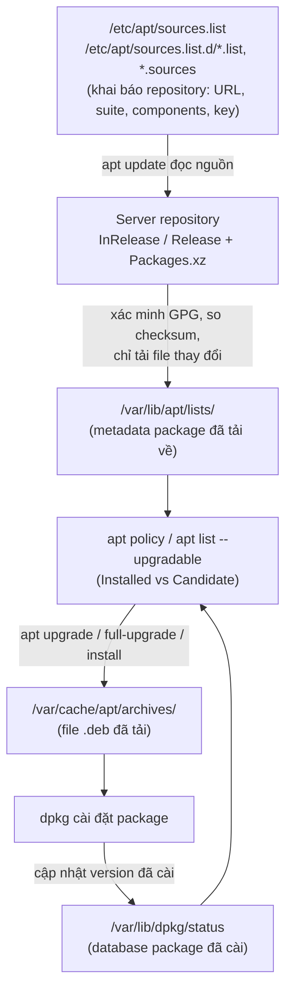

## 1. Luồng hoạt động



## 2. Các thư mục quan trọng

|Đường dẫn|Chứa gì|
|---|---|
|`/etc/apt/sources.list`|Danh sách repository chính (kiểu một dòng)|
|`/etc/apt/sources.list.d/`|Repository tách riêng từng file (`.list` hoặc `.sources` dạng deb822), thường cho repo bên thứ ba|
|`/var/lib/apt/lists/`|Metadata package tải về sau `apt update`|
|`/var/lib/dpkg/status`|Database các package đã cài và version|
|`/var/cache/apt/archives/`|File `.deb` đã tải khi install/upgrade|

## 3. Cú pháp repository

Kiểu một dòng:

```
deb [signed-by=/path/key.gpg] http://archive.ubuntu.com/ubuntu jammy main restricted universe multiverse
```

Kiểu deb822 (Ubuntu 24.04+, Debian 12+):

```
Types: deb
URIs: http://archive.ubuntu.com/ubuntu
Suites: noble noble-updates noble-security
Components: main restricted universe multiverse
Signed-By: /usr/share/keyrings/ubuntu-archive-keyring.gpg
```

- `deb` / `deb-src`: package build sẵn / source code
- Suite: tên bản phát hành (`jammy`, `noble`) và biến thể `-updates`, `-security`, `-backports`
- Components: `main`, `restricted`, `universe`, `multiverse`

## 4. Lệnh cơ bản

### Cập nhật danh sách & nâng cấp

```bash
sudo apt update              # Tải metadata mới, KHÔNG cài gì
apt list --upgradable        # Xem package có bản mới hơn
sudo apt upgrade             # Nâng cấp, không gỡ package nào
sudo apt full-upgrade        # Nâng cấp, cho phép cài thêm/gỡ để giải dependency
```

### Cài đặt & gỡ bỏ

```bash
sudo apt install <pkg>       # Cài package
sudo apt install <pkg>=<ver> # Cài đúng version
sudo apt remove <pkg>        # Gỡ, giữ lại file cấu hình
sudo apt purge <pkg>         # Gỡ cả file cấu hình
sudo apt autoremove          # Gỡ dependency không còn dùng
```

### Tra cứu thông tin

```bash
apt policy <pkg>             # Installed, Candidate, các version theo từng repo + priority
apt show <pkg>               # Thông tin chi tiết package
apt search <keyword>         # Tìm package
apt list --installed         # Liệt kê package đã cài
dpkg -l | grep <pkg>         # Tra trong database dpkg
dpkg -L <pkg>                # File mà package đã cài
```

### Giữ version & dọn cache

```bash
sudo apt-mark hold <pkg>     # Không cho nâng cấp package
sudo apt-mark unhold <pkg>   # Bỏ giữ
apt-mark showhold            # Xem package đang bị hold
sudo apt clean               # Xóa toàn bộ .deb trong cache
sudo apt autoclean           # Chỉ xóa .deb cũ không còn tải được
```

## 5. Ghi nhớ nhanh

- `apt update` chỉ làm mới **danh sách**, so danh sách cũ với server; cuối cùng đối chiếu với `/var/lib/dpkg/status` để báo số package có thể nâng cấp.
- `apt upgrade` mới thực sự tải `.deb` và cài.
- Version mới nhất là mới nhất **trong các repository đã cấu hình**, không phải mới nhất của upstream.
- Candidate version có thể bị ảnh hưởng bởi pin priority và `apt-mark hold`.